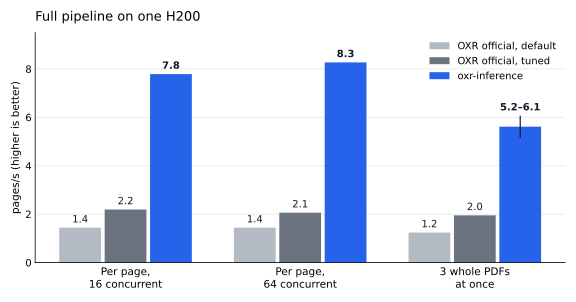
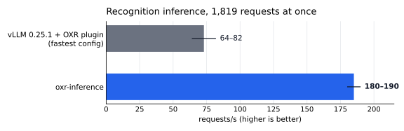

# oxr-inference

English | [简体中文](README_CN.md)

A high-throughput inference server for [SoMark OXR](https://github.com/SoMarkAI/OXR) document parsing. Inference for
the OXR-1.0 recognition model is written from scratch (PyTorch + flash-attn 4 + a few Triton kernels) and does not
depend on vLLM; layout detection, reading order and post-processing reuse OXR's own code, the HTTP API is the same as
OXR's (`POST /v1/parse/sync` and friends), and recognition accuracy matches the official vLLM deployment.

On a single H200, the full pipeline (PDF in, parsed result out) runs at about **8 pages/s**; measured the same way,
the official OXR deployment runs at 1.4–2.2 pages/s.



> This is not an official SoMark project. OXR and OXR-1.0 are released by SoMark Team; this project is a derivative
> work of OXR and is subject to the same additional terms. See [License](#license).

## Highlights

Compared with the official OXR deployment (OXR's API + vLLM + a layout-detection service):

- ⭐ **Much higher throughput**: about 8 pages/s for the full pipeline on one H200, versus 1.4–2.2 pages/s for the official
  deployment measured the same way ([Performance](#performance)).
- ⭐ **No vLLM**: recognition inference is written from scratch (continuous batching, paged KV cache, CUDA Graphs,
  fused kernels), with accuracy matching the official vLLM deployment.
- ⭐ **One process owns the GPU**: recognition and layout detection share one GPU process; memory is reserved and
  checked once at startup, so allocations don't fail halfway through a document.
- ⭐ **Multiple processes**: official `oxr serve` only allows 1 process (async tasks live in memory); here 4 pipeline
  processes run by default and share async tasks.
- ⭐ **Bounded under overload, no hangs on failure**: full queues reply busy or 503; if the GPU process dies the server
  exits for the container to restart, and in-flight requests fail immediately.
- ⭐ **Block-level API**: besides the official `/v1/parse/sync`, you can run layout only (`/v1/layout/sync`) or recognize
  only the blocks you pass (`/v1/recognize/sync`), e.g. send just formulas, tables and code
  ([Block-level API](#block-level-api)).
- ⭐ **Same API**: `/v1/parse/sync` and the other official endpoints are unchanged; callers don't need to change.

## Why

The official OXR deployment is three services: OXR's API and pipeline, vLLM (running the recognition model through
OXR's plugin), and a layout-detection service. Measured on one H200 (see [Performance](#performance)), these are the
slow and fragile parts:

- **Recognition inference is slow.** For the same 1,819 recognition requests, the fastest vLLM configuration (two
  extra patches to the plugin, 4 API server processes) handles 64–82 requests/s, with large run-to-run variance. The
  plugin's preprocessing rebuilds the 150k-entry vocabulary dictionary twice per image, which is 84% of preprocessing
  time; the vision encoder re-interpolates its position embeddings for every image on every forward pass (caching the
  interpolation makes the vision encoder about twice as fast). Every crop is also encoded as PNG and base64 inside
  OXR, sent to vLLM over HTTP and decoded again.
- **The API server runs as a single process.** OXR keeps async-task state in process memory, so `oxr serve` only
  accepts `--workers 1`. PDF rendering goes through a process-wide lock (PDFium can't be used from several threads at
  once), and inside the lock each page is encoded as PNG and decoded again, capping one process at about 11 pages/s.
- **GPU memory is managed separately.** Recognition and layout detection live in two processes that each allocate GPU
  memory without knowing what the other needs. When the GPU is nearly full, layout detection may need extra memory for
  a batch size it hasn't seen before; the allocation fails (`CUBLAS_STATUS_ALLOC_FAILED`) and the whole document
  errors out.

## What's different

**Recognition engine**

- Continuous batching, paged KV cache, greedy decoding. Launching prefills and decoding token by token run on two
  threads and two CUDA streams, the decode stream at higher priority, so the two overlap on the GPU: prefill is
  compute-bound, while each decode step is a string of small kernels.
- Decode steps and speculative-verification steps are replayed from CUDA Graphs; without them a decode step issues
  about 1,100 small operations from the CPU, one after another.
- The small operations in front of every attention layer (q/k normalization, rotary position embedding, writing the
  paged KV cache) are fused into one Triton kernel, cutting the kernels per decode step from 546 to 322; the q/k/v
  and gate/up projections are each merged into a single matmul; element-wise ops are compiled with torch.compile
  while keeping step-by-step rounding, so the rounding points match vLLM.
- Vision encoder: images are batched together; the position-embedding interpolation is cached per grid size;
  attention uses flash-attn 4 (the vision head dim is 72, which flash-attn 2 can only run as 96); the vision
  vocabulary head's weight is padded to a multiple of 64 rows (with 65,532 columns, cuBLAS can only pick very slow
  kernels).
- Preprocessing: resizing is bit-identical to the official plugin; normalization is a table lookup; patchification
  runs on the GPU.
- Speculative decoding at the tail of a batch: when only a few long outputs are left, each sequence guesses its next
  tokens from repeated fragments of what it has already written (no draft model); table-like outputs advance two or
  three tokens per step.
- Repetition early stop (on by default): when the end of an output falls into a loop, generation stops after the
  first cycle and OXR retries the block with a higher repetition penalty.

**Service architecture**

- One GPU process owns the GPU and runs both recognition and layout detection. Several pipeline processes (4 by
  default) run OXR's own API and pipeline and talk to the GPU process over a local Unix socket, sending images as raw
  pixels instead of PNG.
- GPU memory is reserved once at startup: a worst-case warm-up claims the memory for the KV cache, CUDA Graphs,
  prefill activations and every layout batch size, then the free memory left on the GPU is checked. If it's too low,
  the server refuses to start and logs how far short it is and what to change. While serving, it doesn't ask the GPU
  for large allocations any more (across all our load tests the GPU process grew by only about 0.7 GB).
- Bounded under overload: the recognition and layout queues in the GPU process have limits and reply "busy" when
  full, and OXR returns 503 after its retries; each pipeline process also caps concurrent HTTP requests and returns
  503 beyond that.
- Recovers from failures: a crashed pipeline process is restarted by uvicorn; if the GPU process dies, the whole
  server exits so the container gets restarted; in-flight requests fail immediately instead of hanging.
- Async-API tasks are shared across all pipeline processes (finished tasks are kept for 1 hour).
- Optional PDF rendering pool (`--render-processes`): a multi-page document is split by page across several
  processes, with images bit-identical to OXR's own rendering.

## Performance

Test machine: one H200 (141 GB, driver 580.105.08), container limited to 16 CPU cores. Test documents: 85 pages —
10 pages of a scanned classical Chinese book, 15 pages of an English paper and 60 pages of a Chinese textbook —
which layout detection splits into 1,819 recognition requests. All caches were disabled (vLLM's prefix cache and
multimodal cache). An idle vLLM instance held about 30 GB of the same GPU during the tests. In the charts, bars show
the average over runs (the midpoint where only a range was recorded) and thin lines span the minimum to the maximum.

**Full pipeline**: OXR's `POST /v1/parse/sync`, with the client on the same machine.

| Deployment | Per page, 16 concurrent | Per page, 64 concurrent | 3 whole PDFs at once |
|---|---|---|---|
| Official OXR all-in-one, default settings | 1.44 pages/s | 1.44 pages/s | 1.24 pages/s |
| Official OXR, recognition concurrency 128, vLLM max running 256, 4 API server processes | 2.19 pages/s | 2.06 pages/s | 1.95 pages/s |
| **This project** (4 pipeline processes, `--kv-gb 80 --max-running 1024`) | **7.78–7.79 pages/s** | **8.27 pages/s** | **5.16–6.07 pages/s** |

- "Per page" means every page is split into a single-page PDF and sent by concurrent clients. This project already
  peaks at 32 concurrent requests (8.26 pages/s); the bottleneck is the GPU. At full load the whole server uses 4–5
  CPU cores.
- Official default settings (except that caches were disabled): vLLM GPU memory utilization 0.70; the OXR API server
  with 1 process (the only supported value) and recognition concurrency 16 (`OXR__OXR_MODEL__MAX_CONCURRENCY`). The
  official entrypoint sets vLLM's max running sequences to 16; this row was measured with 256, which is equivalent:
  with recognition concurrency 16, vLLM never has more than 16 sequences running. OXR, vLLM, its OXR plugin and the
  layout service were all unmodified (OXR pinned at commit `c1a1dcb`).
- Each official configuration was run once per load pattern; this project was run twice for "per page, 16
  concurrent" and for whole PDFs.

**Recognition inference**: all 1,819 recognition requests sent at once.



| Backend | Requests/s |
|---|---|
| vLLM 0.25.1 + the official OXR plugin, with two patches to the plugin (vocabulary lookup and position-embedding interpolation each computed once), 4 API server processes, KV cache comparable to this project | 64–82 |
| **This project** | **180–190** |

Each side used its production path: vLLM through its HTTP API (images as PNG and base64), this project through the
local socket (raw pixels).

**Accuracy**: edit-distance accuracy against reference text.

| | Classical Chinese (CJK characters only) | English paper | Chinese textbook |
|---|---|---|---|
| vLLM (5 runs) | 97.96% | 88.50% | 95.09%–95.32% |
| **This project** (6 runs) | **97.96%** | **88.46%–88.50%** | **95.30%–95.31%** |

- References: for the paper and the textbook, the PDF's own text layer; the scanned book has no text layer, so its
  reference is the page-by-page output of another vision model (not human-verified). Block outputs are assembled
  into pages in vLLM's reading order before comparing.
- Batches are composed differently in every run, so near-ties (two candidate tokens with almost equal logits) can go
  either way and runs differ slightly; vLLM's runs differ from each other in the same way. The one English-paper run
  at 88.46% comes from a single crop: the text in the image had ended and the model wrote one extra line, and which
  line it writes is a near-tie. This project's block outputs are identical to vLLM's first run for 98.3%–98.8% of
  blocks; vLLM's other 4 runs reach 99.0%–99.2%.
- The test documents are copyrighted and not included. `scripts/parity.py` documents the request-set format, so you
  can reproduce the comparison with your own documents.

**Production deployment**: the published image on our Kubernetes cluster (one H200 per pod, same GPU model), with
requests sent from a separate pod through the Service.

| | Result |
|---|---|
| Pulling the image from GHCR | 5.41 GiB, about 8 min 20 s |
| Startup, from container start to accepting requests (fresh container, no compile cache) | about 42 s |
| GPU memory held by the GPU process | 90.3 GiB of 139.8 GiB (80 GiB KV cache) |
| Per page, 16 concurrent | 7.85 pages/s |
| Per page, 64 concurrent | about 8.6 pages/s |
| 3 whole PDFs at once | 5.37–6.19 pages/s |
| Async API with 4 pipeline processes | 40 of 40 queries found the task |

A single Python load-generator process tops out around 4 pages/s at 64 concurrent requests (the client itself becomes
CPU-bound), so per-page load was spread over several client processes: 2 × 8 and 4 × 16 concurrent requests.

## Quick start

Prebuilt images are on GHCR: version tags such as `v1.0.0` are releases, and `latest` is the newest release.

```bash
docker run --gpus '"device=0"' -p 8000:8000 ghcr.io/nickwilde18/oxr-inference:v1.1.0 --kv-gb 80 --max-running 1024
```

The image contains NVIDIA CUTLASS DSL, which flash-attn 4 uses to compile kernels. Like the public images of vLLM and
SGLang, which install the same package, ours ships it under NVIDIA's own license; see
[THIRD_PARTY_NOTICES.md](THIRD_PARTY_NOTICES.md) and review NVIDIA's terms before use.

To build your own image instead:

- **With GitHub Actions**, no build machine needed: fork this repository, enable workflows on your fork's Actions page,
  and push a tag starting with `v` (for example `v1.0.0`) to your fork. The "Image" workflow pushes the image to
  `ghcr.io/<your-username>/oxr-inference` with that tag and `latest`; the package is private when first pushed. If
  ModelScope is unreachable, run the workflow manually on that tag with `weights_base_url` set to
  `https://huggingface.co/SoMarkAI/OXR-1.0/resolve/main/`.
- **Locally**:

  ```bash
  docker build -t oxr-inference .
  # If ModelScope is unreachable, download the weights from Hugging Face instead:
  docker build --build-arg WEIGHTS_BASE_URL=https://huggingface.co/SoMarkAI/OXR-1.0/resolve/main/ -t oxr-inference .
  ```

  The build downloads the OXR source (pinned commit) and the OXR-1.0 weights (about 2.9 GB, each file checked against
  its sha256); the weights come from ModelScope by default.

At startup the server loads the weights, warms up for the worst case and compiles kernels; it accepts requests once
the log shows `Application startup complete`. The API is the same as OXR's:

```bash
curl -F file=@paper.pdf -F api_key=any -F output_formats=json http://127.0.0.1:8000/v1/parse/sync
```

`api_key` is a field OXR's API requires; neither OXR nor this project checks its value.

### Block-level API

Besides OXR's own endpoints, the server has two endpoints that split `/v1/parse/sync` in two, for callers that only
need part of the pipeline (for example, a PDF page with a text layer: text blocks can be read from the text layer, so
only formulas, tables and code need recognition). Both call OXR's own functions, so their results are the same as
`/v1/parse/sync` at the same step. Request format and error codes are the same as `/v1/parse/sync` (multipart form,
`api_key` required but not checked, 1133 for invalid parameters, 1137 for processing failures).

**`POST /v1/layout/sync`**: layout only. `file` is an image or a PDF (rendered by OXR's own code; boxes are pixel
coordinates on that page image); `feature_config` has the same `keep_header_footer` as `/v1/parse/sync`. Returns each
page's blocks in reading order (`idx` is the position in the reading order):

```bash
curl -F file=@page.png -F api_key=any http://127.0.0.1:8000/v1/layout/sync
# {"code": 0, "data": {"result": {"pages": [{"page_num": 0, "page_size": {"w": 1241, "h": 1754},
#   "blocks": [{"idx": 0, "type": "Title", "bbox": [x1, y1, x2, y2], "score": 0.97}, ...]}]},
#   "metadata": {"layout_time_ms": ..., "reading_order_time_ms": ...}}}
```

OXR's layout model doesn't give a reading order; OXR asks the recognition model for it, once per page (a short output,
a few tokens per block). This endpoint does the same, so each page still makes one recognition-model call. Blocks are
the ones before recognition: after recognizing, `/v1/parse/sync` also removes blocks whose recognized text duplicates
another block's, which can't be done without the text, so this endpoint may return a few more blocks.

**`POST /v1/recognize/sync`**: recognize the given blocks only. `file` is one page (an image, or a one-page PDF);
`blocks` is a JSON array of `{"type": ..., "bbox": [x1, y1, x2, y2]}` in that page's pixel coordinates (as returned by
`/v1/layout/sync`); `extra` and `element_formats` mean the same as in `/v1/parse/sync`. Each block goes through OXR's
own per-block recognition: same crop, same prompt for its type, the same retries when the output hits the length
limit, the same post-processing; formula numbers are folded into the formula as in `/v1/parse/sync`'s JSON. Results
come back in request order (`idx` is the index in the request), without the cross-block cleanup. `Picture` blocks
aren't recognized; crop them yourself (a request with one is rejected).

```bash
curl -F file=@page.png -F api_key=any \
  -F 'blocks=[{"type":"Table","bbox":[90,410,1150,820]},{"type":"Formula","bbox":[300,900,940,980]}]' \
  http://127.0.0.1:8000/v1/recognize/sync
# {"code": 0, "data": {"result": {"blocks": [{"idx": 0, "type": "Table", "bbox": [...], "content": "<table>...",
#   "format": "html"}, {"idx": 1, "type": "Formula", ..., "format": "latex"}]}}}
```

Without Docker:

```bash
pip install torch==2.11.0 torchvision==0.26.0 --index-url https://download.pytorch.org/whl/cu130
pip install -r docker/requirements.lock
git clone https://github.com/SoMarkAI/OXR oxr && git -C oxr checkout c1a1dcb
python docker/fetch_weights.py --manifest docker/weights_manifest.json --out models/OXR-1.0
OXR_COMPILE=1 TORCHINDUCTOR_EMULATE_PRECISION_CASTS=1 OXR_ATTENTION=fa4 \
  python -m oxr_runtime.serve --model models/OXR-1.0 --oxr-src oxr --kv-gb 80 --max-running 1024
```

Triton needs gcc the first time it compiles a kernel.

### Options

| Option | Default | Description |
|---|---|---|
| `--kv-gb` | 16 | GPU memory for the KV cache (GiB). Our H200 tests used 80 |
| `--max-running` | 256 | Maximum sequences running in the engine. Our H200 tests used 1,024 |
| `--max-waiting` | 2048 | Maximum requests queued in the engine; beyond that it replies busy |
| `--workers` | 4 | Number of pipeline processes (OXR's API and pipeline, PDF rendering, resizing) |
| `--preprocess-threads` | 4 | Threads per pipeline process for resizing and layout preprocessing |
| `--layout-queue` | 64 | Maximum layout batches queued in the GPU process, split across the pipeline processes |
| `--limit-concurrency` | 256 | Maximum concurrent HTTP requests per pipeline process; beyond that it returns 503 |
| `--render-processes` | 0 | Extra PDF rendering processes per pipeline process; 0 = OXR's own rendering |
| `--memory-margin-gb` | 2 | GPU memory that must stay free after warm-up, or the server refuses to start |
| `--repetition-span` | 1024 | Window (in tokens) for repetition early stop; 0 disables it |
| `--startup-timeout` | 1800 | Seconds to wait for the GPU process to become ready |

### Environment variables

Already set in the image.

| Variable | Value in the image | Description |
|---|---|---|
| `OXR_COMPILE` | `1` | Compile element-wise ops with torch.compile, warmed up at startup |
| `TORCHINDUCTOR_EMULATE_PRECISION_CASTS` | `1` | Keep step-by-step rounding after compiling, so rounding points match the uncompiled code and vLLM |
| `OXR_ATTENTION` | `fa4` | Attention for the language model: `fa2` (flash-attn 2) or `fa4` (flash-attn 4). The image only ships flash-attn 4 |
| `OXR_VISION_ATTENTION` | unset | Attention for the vision encoder; when unset, flash-attn 4 is used if installed |
| `OXR_PROFILE` | unset | Set to `1` to time each stage (slightly slower) |

## Code layout

| Module | What it does |
|---|---|
| `oxr_runtime/serve.py` | Launcher: starts the GPU process, then the pipeline processes with uvicorn once it's ready; exits the whole server if the GPU process dies |
| `oxr_runtime/gpu_server.py` | GPU process: recognition engine and layout detection; reserves and checks GPU memory at startup; bounded queues |
| `oxr_runtime/worker.py` | Pipeline process: OXR's API and pipeline, with the recognition and layout calls sent to the GPU process |
| `oxr_runtime/ipc.py` | Communication between pipeline processes and the GPU process (local Unix socket, arrays sent as raw bytes) |
| `oxr_runtime/tasks.py` | Async-task store shared by all pipeline processes |
| `oxr_runtime/blocks.py` | Block-level endpoints: `/v1/layout/sync` (layout and reading order only) and `/v1/recognize/sync` (recognize given blocks only) |
| `oxr_runtime/engine.py` | Inference engine: continuous batching, two threads and two streams, preemption and recompute when the KV cache runs out, repetition early stop, speculative decoding, cancellation, warm-up |
| `oxr_runtime/vision.py` | Vision encoder (SigLIP2-NaViT) and vision vocabulary head |
| `oxr_runtime/language.py` | Language model (Qwen3 architecture): prefill, decode and speculative-verification forward passes |
| `oxr_runtime/kernels.py` | Triton kernel: q/k normalization + rotary position embedding + writing the paged KV cache |
| `oxr_runtime/decode_graph.py` | CUDA Graphs for decode and speculative verification |
| `oxr_runtime/attention.py` | Common interface over flash-attn 2 and 4 |
| `oxr_runtime/speculative.py` | Speculative decoding without a draft model |
| `oxr_runtime/preprocess.py` | Preprocessing: resizing, normalization, patchification |
| `oxr_runtime/layout.py` | Layout detection: uses the official layout service's runtime directly, with results bit-identical to the service |
| `oxr_runtime/render.py` | PDF rendering pool |
| `scripts/parity.py`, `scripts/divergence.py` | Block-by-block comparison with vLLM's outputs and timing; finding the token where two outputs diverge |
| `scripts/plot_performance.py` | Draws the performance charts in `docs/images/` |

## Tests

```bash
PYTHONPATH=.:tests python -m pytest -q tests
```

Most tests run on the CPU: attention is replaced by a pure-PyTorch stand-in and Triton kernels run in interpreter
mode. With `OXR_SRC` (path to the OXR source) set, the tests involving OXR's API also run; with a GPU and flash-attn 4,
the CUDA Graph priority test runs; with `OXR_MODEL` (path to the weights) set as well, the tests that start the real
server run.

## Known limitations

- Greedy decoding only. OXR defaults to temperature=0 and top_p=1; requests asking for other values get a warning and
  are still decoded greedily.
- Block-by-block recognition only (OXR's official pipeline); the whole-page recognition mode isn't implemented.
- One server per GPU; on multi-GPU machines, run one server per GPU.
- Requires NVIDIA driver 580 or newer (CUDA 13).
- flash-attn 4 is still a pre-release (4.0.0b37).
- After upgrading torch, re-check three things: the step-by-step rounding switch
  (`TORCHINDUCTOR_EMULATE_PRECISION_CASTS`) still exists and results are still correct;
  `tests/test_decode_graph_priority.py` (since torch 2.11, CUDA Graphs run at the priority of the stream they were
  captured on); layout detection still matches the official service page by page.
- Finished async-API tasks are kept for 1 hour and can't be queried after that; after a restart, earlier tasks can't
  be queried (same as OXR).

## License

This project is a derivative work of [OXR](https://github.com/SoMarkAI/OXR) and, like OXR, is licensed under the
Apache License 2.0 subject to OXR's additional terms; see [LICENSE](LICENSE) for the full text (Copyright © 2026
Yechi Yang). The key points of the additional terms (the original text prevails):

- If you and your affiliates, on a consolidated basis, exceed USD 2,000,000 in total funding or annual revenue, you
  need a commercial license from SoMark Team before commercial use;
- When providing an online service to third parties, you must prominently identify SoMark OXR in the service's user
  interface or public documentation;
- You may not offer third parties a hosted API service that competes with SoMark's (document parsing, OCR, layout
  analysis, content extraction); use solely within your own organization isn't restricted by this term.

The image also contains the OXR source, the OXR-1.0 weights and third-party software, each under its own license; see
[THIRD_PARTY_NOTICES.md](THIRD_PARTY_NOTICES.md). NVIDIA CUTLASS DSL (a flash-attn 4 dependency) is under a
proprietary NVIDIA license; like the public images of vLLM and SGLang, ours includes it. Review NVIDIA's terms before
using or redistributing the image.
