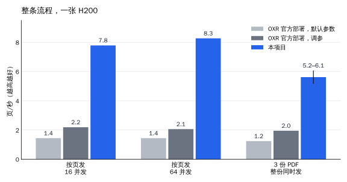
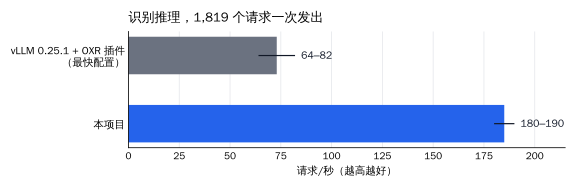

# oxr-inference

[English](README.md) | 简体中文

[SoMark OXR](https://github.com/SoMarkAI/OXR) 文档解析的高吞吐推理服务。识别模型 OXR-1.0 的推理是自己写的
（PyTorch + flash-attn 4 + 几个 Triton kernel），不依赖 vLLM；版面检测、阅读顺序、后处理照用 OXR 官方的代码，
对外接口和 OXR 官方相同（`POST /v1/parse/sync` 等），识别准确率和官方的 vLLM 部署相当。

一张 H200 上，整条流程（PDF 进、解析结果出）约 **8 页/秒**；同样的测法下，OXR 官方部署是 1.4–2.2 页/秒。



> 本项目不是 SoMark 的官方项目。OXR 和 OXR-1.0 由 SoMark Team 发布；本项目是 OXR 的衍生作品，同样受 OXR 附加
> 条款约束，见[许可证](#许可证)。

## 痛点

OXR 官方部署是三个服务：OXR 的接口和流程、vLLM（加载 OXR 的插件跑识别模型）、版面检测服务。在一张 H200 上实测
（测法见[性能](#性能)），慢和不稳的地方在这几处：

- **识别模型的推理跑不快**。同一批 1,819 个识别请求，vLLM 最快的配置（另给插件打了两处补丁、开 4 个 API 进程）
  64–82 请求/秒，多轮之间波动大。插件的预处理每张图要两次把 15 万词的词表重建成字典，占预处理时间的 84%；视觉
  编码每次前向都给每张图重新插值位置编码，缓存插值结果后视觉编码快约一倍。每块裁图还要在 OXR 里编成 PNG、
  base64，经 HTTP 发给 vLLM，再解码回来。
- **接口只能单进程**。OXR 的异步接口把任务存在进程内存里，`oxr serve` 只许 `--workers 1`。PDF 渲染要过一把
  进程级的锁（PDFium 不能多线程同时用），锁里还要把页面编成 PNG 再解码，单进程最多约 11 页/秒。
- **显存各管各的**。识别和版面检测在两个进程里，各自向显卡要显存，谁也不知道对方要多少。卡上显存紧的时候，
  版面检测碰上没见过的批大小要临时多要显存，申请失败（`CUBLAS_STATUS_ALLOC_FAILED`），整份文档报错。

## 做了什么

**识别模型的推理引擎**

- 连续批处理、分页 KV 缓存、贪心解码。发起 prefill 和逐字生成分在两个线程、两条 CUDA 流上，逐字生成那条流
  优先级更高，GPU 上两边叠着跑：prefill 吃算力，逐字生成每一步只是一串小 kernel。
- 逐字生成和投机验证这两步用 CUDA Graph 回放；不回放时，逐字生成一步要从 CPU 依次发出约 1,100 个小操作。
- 每层注意力前面的那串小操作（q/k 归一化、旋转位置编码、写分页 KV 缓存）合成一个 Triton kernel，逐字生成每一步
  的 kernel 数从 546 个降到 322 个；q/k/v、gate/up 投影各并成一次矩阵乘；逐元素操作用 torch.compile 编译，并保持
  逐步舍入，舍入点和 vLLM 相同。
- 视觉编码器：多张图拼成一批算；位置编码插值按网格尺寸缓存；注意力用 flash-attn 4（视觉的头维度是 72，
  flash-attn 2 只能按 96 算）；视觉词表头的权重补到 64 的倍数行（65532 列时 cuBLAS 只能选很慢的 kernel）。
- 预处理：缩放和官方插件逐位相同；归一化查表；切 patch 在 GPU 上做。
- 收尾阶段的投机解码：一批快做完、只剩几条长输出时，每条序列从自己已经写出的内容里找重复片段来猜接下来的
  token（不用草稿模型），表格这类输出一步能前进两三个 token。
- 复读提前停（默认开）：输出末尾陷进循环时停在第一遍之后，交给 OXR 调高重复惩罚重试。

**服务结构**

- 一个 GPU 进程独占显卡，识别和版面检测都在里面；几个流程进程（默认 4 个）跑 OXR 官方的接口和流程，经本机 Unix
  套接字找 GPU 进程算，图按原始像素传，不编 PNG。
- 显存在启动时一次占好：按最坏情况预热，把 KV 缓存、CUDA Graph、prefill 的激活、版面检测各种批大小要的显存都
  先占住，再核对整卡的余量，不够就拒绝启动，日志里写差多少、怎么调。服务时不再向显卡要大块显存（各种压法跑下来，
  GPU 进程的显存只涨了约 0.7 GB）。
- 过载有边界：GPU 进程里识别和版面检测的排队都有上限，满了回忙，OXR 重试之后回 503；每个流程进程同时处理的
  HTTP 请求也有上限，超出直接回 503。
- 出了故障能恢复：流程进程挂了，uvicorn 拉起一个新的；GPU 进程挂了，整个服务退出，交给容器重启；在路上的请求立刻
  失败，不会挂住。
- 异步接口的任务在所有流程进程之间共享（做完的任务保留 1 小时）。
- 可选的 PDF 渲染进程池（`--render-processes`）：一份多页文档按页拆给几个进程同时渲染，图和 OXR 自己渲染的逐位
  相同。

## 性能

测试机：一张 H200（显存 141 GB，驱动 580.105.08），容器限 16 个 CPU 核。测试文档 85 页：古籍扫描件 10 页、英文论文
15 页、中文教材 60 页，版面检测后拆成 1,819 个识别请求。所有缓存都关掉（vLLM 的前缀缓存和多模态缓存）。测试时卡上
另有一个空闲的 vLLM 实例占着约 30 GB 显存。图里的柱高是各遍的平均（只记了范围的取中点），细线是各遍的最小到最大。

**整条流程**：OXR 的 `POST /v1/parse/sync`，客户端在同一台机器上。

| 部署 | 按页发，16 并发 | 按页发，64 并发 | 3 份 PDF 整份同时发 |
|---|---|---|---|
| OXR 官方一体化部署，默认参数 | 1.44 页/秒 | 1.44 页/秒 | 1.24 页/秒 |
| OXR 官方部署，识别并发调到 128，vLLM 同时在跑上限 256、开 4 个 API 进程 | 2.19 页/秒 | 2.06 页/秒 | 1.95 页/秒 |
| **本项目**（4 个流程进程，`--kv-gb 80 --max-running 1024`） | **7.78–7.79 页/秒** | **8.27 页/秒** | **5.16–6.07 页/秒** |

- 「按页发」是把每一页拆成单页 PDF，多个客户端并发地发。本项目在 32 并发时就到顶了（8.26 页/秒），瓶颈在 GPU；
  跑满时整个服务用 4–5 个 CPU 核。
- 官方的默认参数（除了关掉缓存）：vLLM 显存比例 0.70；OXR 接口 1 个进程（只支持 1 个），识别并发 16
  （`OXR__OXR_MODEL__MAX_CONCURRENCY`）。官方入口给 vLLM 的同时在跑上限是 16，这一行测的时候是 256：识别并发是
  16，vLLM 里同时在跑的不会超过 16，两者等价。OXR、vLLM 和它的 OXR 插件、版面检测服务都是原样的（OXR 固定在提交
  `c1a1dcb`）。
- 官方的每种发法跑了一遍，本项目跑了两遍（按页 16 并发、整份同时发两种）。

**识别模型的推理**：1,819 个识别请求一次全部发出。



| 推理后端 | 请求/秒 |
|---|---|
| vLLM 0.25.1 + OXR 官方插件，给插件打了两处补丁（词表查询、位置编码插值都只算一次），4 个 API 进程，KV 缓存和本项目相当 | 64–82 |
| **本项目** | **180–190** |

两边走的都是各自线上的路：vLLM 经它的 HTTP 接口（图编成 PNG、base64），本项目经本机套接字（原始像素）。

**准确率**：和参照文字比，按编辑距离算。

| | 古籍（只比汉字） | 英文论文 | 中文教材 |
|---|---|---|---|
| vLLM（5 轮） | 97.96% | 88.50% | 95.09%–95.32% |
| **本项目**（6 遍） | **97.96%** | **88.46%–88.50%** | **95.30%–95.31%** |

- 参照：论文和教材用 PDF 自带的文字层；古籍扫描件没有文字层，参照是另一个视觉模型的逐页识别结果（不是人工校对）。
  逐块的识别结果统一按 vLLM 的阅读顺序拼成页再比。
- 每一遍的批次组成不同，近似平局的地方（两个候选 token 的 logit 几乎相等）选哪个会变，所以遍与遍之间有零星差别，
  vLLM 各轮之间也是这样。英文论文那一遍 88.46% 来自一块裁图：图里的文字已经结束，模型在后面多编了一行，编哪一句
  是近似平局。本项目各遍的逐块结果和 vLLM 第一轮完全相同的比例是 98.3%–98.8%，vLLM 另外 4 轮是 99.0%–99.2%。
- 测试文档有版权，不随仓库发布。`scripts/parity.py` 写了请求集的格式，可以拿自己的文档复现。

**生产部署实测**：公开发布的镜像跑在我们的 Kubernetes 集群上（每个 pod 一张 H200，和上面同型号），请求从另一个 pod 经
Service 发过来。

| | 结果 |
|---|---|
| 从 GHCR 拉镜像 | 5.41 GiB，约 8 分 20 秒 |
| 启动：从容器启动到能接请求（全新容器，没有编译缓存） | 约 42 秒 |
| GPU 进程占的显存 | 整卡 139.8 GiB 里占 90.3 GiB（KV 缓存 80 GiB） |
| 按页发，16 并发 | 7.85 页/秒 |
| 按页发，64 并发 | 约 8.6 页/秒 |
| 3 份 PDF 整份同时发 | 5.37–6.19 页/秒 |
| 异步接口，4 个流程进程 | 查询 40 次，40 次都查到任务 |

单个 Python 压测客户端进程在 64 并发时只能压到约 4 页/秒（客户端自己先吃满 CPU），所以按页发的压力分给几个客户端进程：
2 × 8 并发、4 × 16 并发。

## 快速开始

构建好的镜像在 GHCR 上：`v1.0.0` 这类版本标签是正式版本，`latest` 是最新的正式版本。

```bash
docker run --gpus '"device=0"' -p 8000:8000 ghcr.io/nickwilde18/oxr-inference:v1.1.0 --kv-gb 80 --max-running 1024
```

镜像里带着 NVIDIA CUTLASS DSL（flash-attn 4 编译 kernel 要用）。和 vLLM、SGLang 的公开镜像一样（它们装的是同一个包），
它按 NVIDIA 自己的许可协议随镜像分发，见 [THIRD_PARTY_NOTICES.md](THIRD_PARTY_NOTICES.md)，使用前请先看 NVIDIA 的条款。

想自己构建的话：

- **用 GitHub Actions**，不用自己准备构建机：fork 本仓库，在 fork 的 Actions 页面启用 workflow，往 fork 推一个 `v` 开头
  的标签（比如 `v1.0.0`）。「Image」构建流程会把镜像推到 `ghcr.io/<你的用户名>/oxr-inference`，打上这个标签和 `latest`，
  包第一次推送时默认私有。ModelScope 不通时，在这个标签上手动运行构建流程，`weights_base_url` 填
  `https://huggingface.co/SoMarkAI/OXR-1.0/resolve/main/`。
- **在本机构建**：

  ```bash
  docker build -t oxr-inference .
  # ModelScope 不通时换 Hugging Face：
  docker build --build-arg WEIGHTS_BASE_URL=https://huggingface.co/SoMarkAI/OXR-1.0/resolve/main/ -t oxr-inference .
  ```

  构建时会下载 OXR 源码（固定提交）和 OXR-1.0 权重（约 2.9 GB，逐个校验 sha256），权重默认从 ModelScope 下载。

启动时加载权重、按最坏情况预热、现编 kernel，日志里出现 `Application startup complete` 之后开始接请求。接口和
OXR 官方相同：

```bash
curl -F file=@paper.pdf -F api_key=any -F output_formats=json http://127.0.0.1:8000/v1/parse/sync
```

`api_key` 是 OXR 的接口要求带的字段，OXR 和本项目都不校验它的值。

### 按块的接口

除了 OXR 自己的接口，服务还有两个接口，把 `/v1/parse/sync` 拆成两段，给只要其中一部分的调用方用（比如有文字层的
PDF 页：文字类块的字可以从文字层取，只有公式、表格、代码要识别）。两个接口都直接调 OXR 自己的函数，结果和
`/v1/parse/sync` 走到同一步时相同。请求格式、错误码和 `/v1/parse/sync` 一样（multipart 表单、`api_key` 必填但不校验、
参数错误 1133、处理失败 1137）。

**`POST /v1/layout/sync`**：只做版面。`file` 是图片或 PDF（PDF 按 OXR 自己的渲染转成页图，框是那张页图上的像素坐标）；
`feature_config` 里的 `keep_header_footer` 和 `/v1/parse/sync` 同义。回每页的块，按阅读顺序排好（`idx` 是阅读顺序里的位置）：

```bash
curl -F file=@page.png -F api_key=any http://127.0.0.1:8000/v1/layout/sync
# {"code": 0, "data": {"result": {"pages": [{"page_num": 0, "page_size": {"w": 1241, "h": 1754},
#   "blocks": [{"idx": 0, "type": "Title", "bbox": [x1, y1, x2, y2], "score": 0.97}, ...]}]},
#   "metadata": {"layout_time_ms": ..., "reading_order_time_ms": ...}}}
```

OXR 的版面模型不给阅读顺序，OXR 是每页调一次识别模型算的（输出很短，每块几个 token）。这个接口照样做，所以每页仍
有一次识别模型调用。回的是识别之前的块：`/v1/parse/sync` 识别完还会按识别出的字删掉重复的块，没有字做不了，所以这里
可能比 `/v1/parse/sync` 多几块。

**`POST /v1/recognize/sync`**：只识别指定的块。`file` 是一页（图片，或只有一页的 PDF）；`blocks` 是 JSON 数组，每项
`{"type": ..., "bbox": [x1, y1, x2, y2]}`，是这一页上的像素坐标（和 `/v1/layout/sync` 回的一样）；`extra`、
`element_formats` 和 `/v1/parse/sync` 同义。每块都走 OXR 自己的逐块识别：裁图、按类型选的提示词、输出到长度上限时的
重试、后处理都一样；公式编号像 `/v1/parse/sync` 的 JSON 那样并进公式。结果按请求的顺序回（`idx` 是请求里的下标），
不做跨块清理。`Picture` 块不识别，调用方自己裁图（请求里带了直接报参数错误）。

```bash
curl -F file=@page.png -F api_key=any \
  -F 'blocks=[{"type":"Table","bbox":[90,410,1150,820]},{"type":"Formula","bbox":[300,900,940,980]}]' \
  http://127.0.0.1:8000/v1/recognize/sync
# {"code": 0, "data": {"result": {"blocks": [{"idx": 0, "type": "Table", "bbox": [...], "content": "<table>...",
#   "format": "html"}, {"idx": 1, "type": "Formula", ..., "format": "latex"}]}}}
```

不用镜像时：

```bash
pip install torch==2.11.0 torchvision==0.26.0 --index-url https://download.pytorch.org/whl/cu130
pip install -r docker/requirements.lock
git clone https://github.com/SoMarkAI/OXR oxr && git -C oxr checkout c1a1dcb
python docker/fetch_weights.py --manifest docker/weights_manifest.json --out models/OXR-1.0
OXR_COMPILE=1 TORCHINDUCTOR_EMULATE_PRECISION_CASTS=1 OXR_ATTENTION=fa4 \
  python -m oxr_runtime.serve --model models/OXR-1.0 --oxr-src oxr --kv-gb 80 --max-running 1024
```

Triton 第一次编 kernel 时要用 gcc。

### 参数

| 参数 | 默认 | 说明 |
|---|---|---|
| `--kv-gb` | 16 | KV 缓存占多少显存（GiB）。H200 上测试用的是 80 |
| `--max-running` | 256 | 引擎里同时在跑的序列上限。H200 上测试用的是 1,024 |
| `--max-waiting` | 2048 | 引擎里排队的请求上限，满了回忙 |
| `--workers` | 4 | 流程进程数（OXR 的接口和流程、PDF 渲染、缩放） |
| `--preprocess-threads` | 4 | 每个流程进程里做缩放、版面预处理的线程数 |
| `--layout-queue` | 64 | GPU 进程里版面检测排队的批数上限，按流程进程数分摊 |
| `--limit-concurrency` | 256 | 每个流程进程同时处理的 HTTP 请求上限，超出回 503 |
| `--render-processes` | 0 | 每个流程进程另开几个 PDF 渲染进程；0 = 用 OXR 自己的渲染 |
| `--memory-margin-gb` | 2 | 预热之后整卡至少要空着的显存，不够就拒绝启动 |
| `--repetition-span` | 1024 | 复读提前停的窗口（token 数），0 关掉 |
| `--startup-timeout` | 1800 | 等 GPU 进程就绪的秒数 |

### 环境变量

镜像里已经设好。

| 变量 | 镜像里的值 | 说明 |
|---|---|---|
| `OXR_COMPILE` | `1` | 逐元素操作用 torch.compile 编译，启动时预热 |
| `TORCHINDUCTOR_EMULATE_PRECISION_CASTS` | `1` | 编译后仍按逐步舍入算，舍入点和不编译时、和 vLLM 相同 |
| `OXR_ATTENTION` | `fa4` | 语言模型的注意力：`fa2`（flash-attn 2）或 `fa4`（flash-attn 4）。镜像里只装了 flash-attn 4 |
| `OXR_VISION_ATTENTION` | 不设 | 视觉编码器的注意力；不设时装了 flash-attn 4 就用它 |
| `OXR_PROFILE` | 不设 | 设成 `1` 时按阶段计时（会拖慢一点） |

## 代码结构

| 模块 | 做什么 |
|---|---|
| `oxr_runtime/serve.py` | 启动：先起 GPU 进程，就绪后用 uvicorn 起几个流程进程；GPU 进程挂了整个服务退出 |
| `oxr_runtime/gpu_server.py` | GPU 进程：识别引擎和版面检测，显存启动时占好并核对余量，排队有上限 |
| `oxr_runtime/worker.py` | 流程进程：OXR 的接口和流程，调识别和版面检测的地方换成发给 GPU 进程 |
| `oxr_runtime/ipc.py` | 流程进程和 GPU 进程之间的通信（本机 Unix 套接字，数组按原始字节传） |
| `oxr_runtime/tasks.py` | 所有流程进程共用的异步任务存储 |
| `oxr_runtime/blocks.py` | 按块的接口：`/v1/layout/sync`（只做版面和阅读顺序）、`/v1/recognize/sync`（只识别指定的块） |
| `oxr_runtime/engine.py` | 推理引擎：连续批处理、两个线程两条流、KV 不够时挤出重算、复读提前停、投机解码、取消、预热 |
| `oxr_runtime/vision.py` | 视觉编码器（SigLIP2-NaViT）和视觉词表头 |
| `oxr_runtime/language.py` | 语言模型（Qwen3 结构）：prefill、逐字生成、投机验证三种前向 |
| `oxr_runtime/kernels.py` | Triton kernel：q/k 归一化 + 旋转位置编码 + 写分页 KV 缓存 |
| `oxr_runtime/decode_graph.py` | 逐字生成、投机验证的 CUDA Graph |
| `oxr_runtime/attention.py` | flash-attn 2 / 4 的统一接口 |
| `oxr_runtime/speculative.py` | 不用草稿模型的投机解码 |
| `oxr_runtime/preprocess.py` | 预处理：缩放、归一化、切 patch |
| `oxr_runtime/layout.py` | 版面检测：直接用 OXR 官方服务的运行时，结果和官方服务逐位相同 |
| `oxr_runtime/render.py` | PDF 渲染进程池 |
| `scripts/parity.py`、`scripts/divergence.py` | 和 vLLM 的输出逐块比对、计时；逐 token 找分叉的位置 |
| `scripts/plot_performance.py` | 画 `docs/images/` 里的性能对比图 |

## 测试

```bash
PYTHONPATH=.:tests python -m pytest -q tests
```

大部分用例在 CPU 上跑：注意力换成纯 PyTorch 的替身，Triton kernel 用解释器模式跑。设了 `OXR_SRC`（OXR 源码目录）时，
另跑和 OXR 接口有关的用例；有 GPU、装了 flash-attn 4 时，另跑 CUDA Graph 优先级的用例；再设 `OXR_MODEL`（权重目录）
时，另跑真起服务的用例。

## 已知限制

- 只支持贪心解码。OXR 默认 temperature=0、top_p=1，请求要别的值时记一条警告，照样贪心。
- 只做逐块识别（OXR 官方的流程），没做整页识别模式。
- 一个服务用一张卡，多卡就起多个服务。
- 要 580 以上的驱动（CUDA 13）。
- flash-attn 4 还是预发布版（4.0.0b37）。
- 升级 torch 要复测三件事：逐步舍入的开关（`TORCHINDUCTOR_EMULATE_PRECISION_CASTS`）还在、结果还对；
  `tests/test_decode_graph_priority.py`（torch 2.11 起 CUDA Graph 按录制那条流的优先级跑）；版面检测和官方服务逐页
  相同。
- 异步接口的任务做完后保留 1 小时，过期就查不到；服务重启之后，之前的任务都查不到（和 OXR 官方一样）。

## 许可证

本项目是 [OXR](https://github.com/SoMarkAI/OXR) 的衍生作品，和 OXR 一样按 Apache License 2.0 许可，同时受 OXR 的
附加条款约束，全文见 [LICENSE](LICENSE)（版权所有 © 2026 Yechi Yang）。附加条款的要点如下，以原文为准：

- 你和关联方合并计算的累计融资或年收入超过 200 万美元时，商用要先向 SoMark Team 取得商业许可；
- 向第三方提供在线服务时，要在界面或公开文档里显著标明使用了 SoMark OXR；
- 不得向第三方提供和 SoMark 竞争的托管 API 服务（文档解析、OCR、版面分析、内容提取）；只在本组织内部使用不受这一条
  限制。

镜像里还有 OXR 源码、OXR-1.0 权重和第三方软件，各自的许可证见 [THIRD_PARTY_NOTICES.md](THIRD_PARTY_NOTICES.md)。
其中 NVIDIA CUTLASS DSL（flash-attn 4 依赖）是 NVIDIA 的专有许可；和 vLLM、SGLang 的公开镜像一样，本项目的镜像也带着它。
使用或再分发镜像之前，请先看 NVIDIA 的条款。
